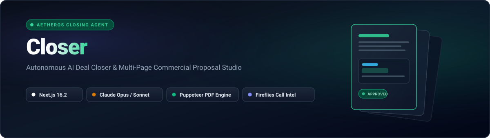
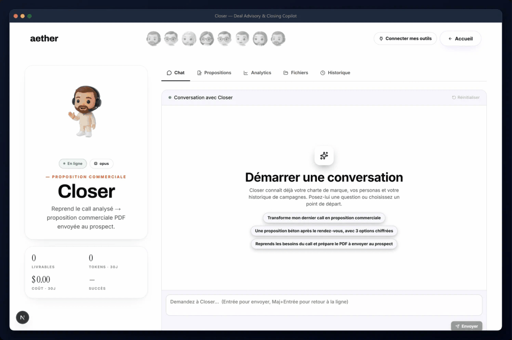
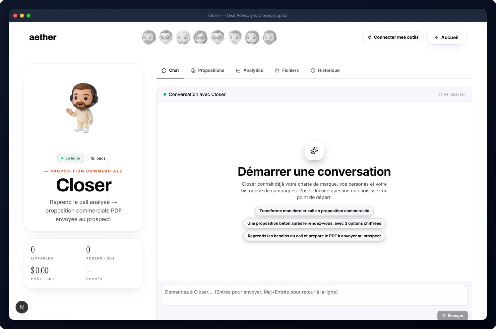
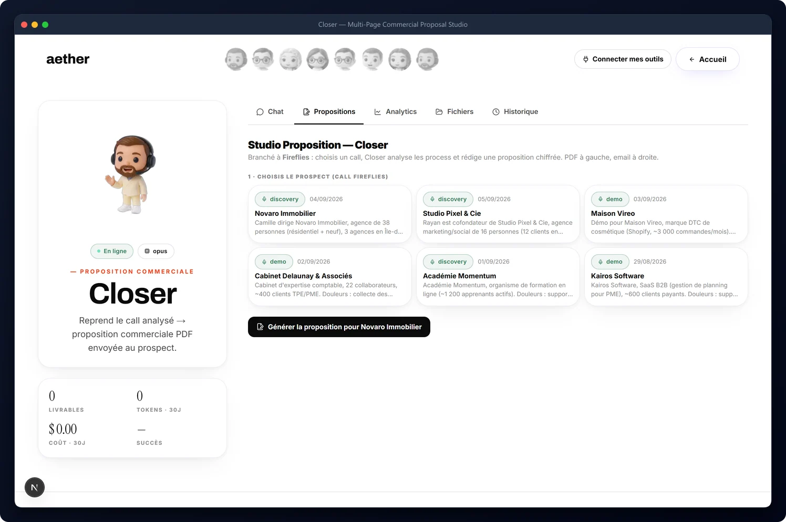
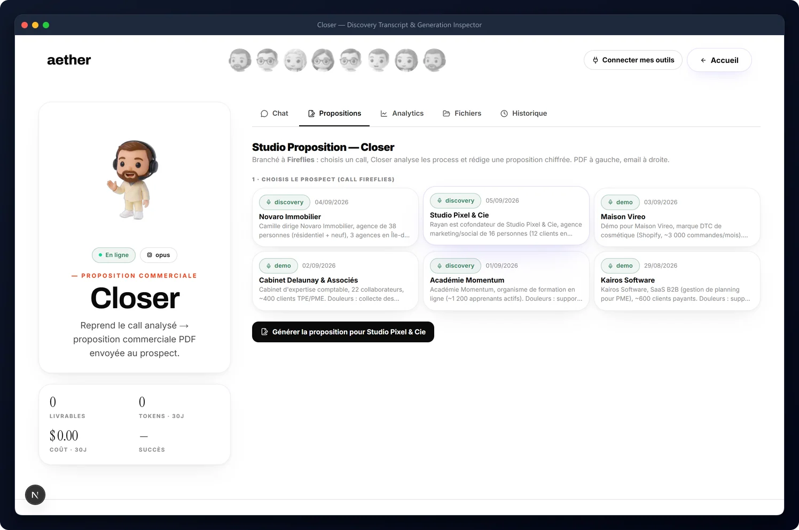
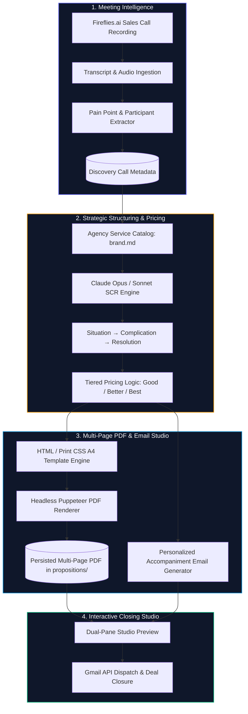

<div align="center">



# Closer — AI Deal Closer & Multi-Page Commercial Proposal PDF Studio

[](https://nextjs.org/)
[](https://react.dev/)
[](https://www.typescriptlang.org/)
[](https://www.anthropic.com/)
[](https://github.com/)
[](LICENSE)

<p align="center">
  <a href="#live-demo"><b>Live Demo</b></a> •
  <a href="#screenshots"><b>Screenshots</b></a> •
  <a href="#key-capabilities--studio-ui"><b>Capabilities</b></a> •
  <a href="#architecture"><b>Architecture</b></a> •
  <a href="#how-to-install--configure"><b>Installation</b></a> •
  <a href="#how-to-use"><b>How to Use</b></a>
</p>

</div>

---

**Closer** is an autonomous AI sales closing copilot and commercial proposal studio. Powered by Fireflies meeting intelligence, Anthropic Claude (Opus/Sonnet) strategic structuring, and headless Puppeteer PDF rendering, Closer transforms raw discovery call transcripts and prospect pain points into high-converting, multi-page commercial proposals and pre-drafted client delivery emails.

---

## Live Demo



---

## Screenshots

<table>
  <tr>
    <td width="50%" align="center">
      <br />
      <b>Closer Command View &amp; Deal Advisory Copilot</b><br />
      <sub>Strategic deal review, objection handling, and pricing tier calibration</sub>
    </td>
    <td width="50%" align="center">
      <br />
      <b>Dual-Pane Proposal Studio Overview</b><br />
      <sub>Interactive workspace with live A4 PDF preview and synchronized accompaniment email</sub>
    </td>
  </tr>
  <tr>
    <td colspan="2" align="center">
      <br />
      <b>Discovery Call Selection &amp; Generation Inspector</b><br />
      <sub>Ingestion of Fireflies meeting notes and one-click SCR commercial proposal generation</sub>
    </td>
  </tr>
</table>

---

## Key Capabilities & Studio UI

### Value-Driven Sales Frameworks
- **Situation → Complication → Resolution (SCR)**: Narratives crafted around the client's current pain points, root bottlenecks, and targeted operational transformation.
- **Value-Based Selling**: Price is never presented bare; each pricing tier maps directly to quantified time savings, revenue uplift, and cost elimination.
- **Tiered Proposal Anchoring (Good / Better / Best)**: 3 strategic investment options that anchor value and empower decision makers, centering on the target tier.
- **Preemptive Objection Neutralization**: Directly incorporates specific concerns and budget remarks raised during discovery meetings.

### Specialized Studio UI
- **Dual-Pane Interactive Studio**:
  - **Left Pane (Multi-Page A4 PDF Viewer)**: Live inline preview of the client-facing PDF without requiring manual download. Features process diagrams, before-and-after workflow schematics, itemized investment tables (setup + recurring retainer), and implementation timelines rendered via Puppeteer.
  - **Right Pane (Delivery Email)**: Clean, pre-drafted accompaniment email separated from the PDF document. Fully editable with one-click approval and automated Gmail dispatch.
- **Meeting Intelligence Integration**: Direct ingestion of Fireflies call summaries or built-in demo discovery transcripts for instant proposal generation.
- **Single-Agent Focus**: Dedicated standalone mode via `OWNED_AGENT=proposition`, providing a streamlined interface designed specifically for closing deals.

---

## Architecture

### System Flowchart



### Directory Structure

```
closer-proposal-studio/
├── .claude/
│   └── agents/
│       └── proposition.md       # Closer agent blueprint, closing rules & SCR framework
├── aether-studio/               # Next.js 16 full-stack Studio application
│   ├── src/
│   │   ├── app/                 # Next.js App Router (Studio views & PDF/email API endpoints)
│   │   ├── components/          # React 19 UI components & dual-pane ProposalStudio
│   │   └── lib/
│   │       ├── propositions/    # Proposal generator (JSON schema) & Puppeteer PDF engine
│   │       └── integrations/    # Fireflies client, Gmail API & Anthropic SDK
│   ├── .env.example             # Documented environment variables template
│   └── package.json             # Studio dependencies & scripts
├── clients/
│   └── votre-marque/
│       └── brand.md             # Agency positioning, pricing tiers & service catalog
├── docs/
│   └── screenshots/             # Framed WebP captures and demo assets
│       ├── closer-agent-view.webp # Unified deal advisory copilot
│       ├── closer-call-selection.webp # Discovery transcript & generation inspector
│       ├── closer-proposal-studio.webp # Multi-page proposal studio
│       ├── demo.gif             # Real interactive studio recording
│       └── hero-banner.svg      # Clean dark-slate presentation vector banner
├── propositions/                # Output directory for generated proposal markdown & PDFs
├── CLAUDE.md                    # Zero-friction agent launch instructions
└── README.md                    # Repository documentation
```

---

## How to Install & Configure

Follow these steps to set up and run Closer locally:

### 1. Prerequisites
- **Node.js**: v20.x or higher (`node -v`)
- **npm**: v10.x or higher (`npm -v`)
- **Anthropic API Key**: Obtain from [Anthropic Console](https://console.anthropic.com/settings/keys)
- **Fireflies API Key**: (Optional) Obtain from [Fireflies.ai Integrations](https://app.fireflies.ai/integrations) (demo discovery calls are built-in)
- **Google Cloud OAuth Credentials**: (Optional for Gmail proposal delivery) Set up via [Google Cloud Console](https://console.cloud.google.com/)

### 2. Clone Repository & Install Dependencies
```bash
git clone https://github.com/Emincanozen/closer-proposal-studio.git
cd closer-proposal-studio/aether-studio
npm install --no-audit --no-fund
```

### 3. Environment Configuration
Copy `.env.example` into `.env.local`:
```bash
cp .env.example .env.local
```

Configure your secrets in `.env.local`:
```env
# Anthropic Claude API Key (Required for proposal reasoning and copywriting)
ANTHROPIC_API_KEY="sk-ant-api..."

# Standalone Template Lock (Preset to proposition)
OWNED_AGENT=proposition
NEXT_PUBLIC_OWNED_AGENT=proposition

# Fireflies API Key (Optional: connects live recorded sales calls)
# FIREFLIES_API_KEY="your_fireflies_key"
# FIREFLIES_MOCK=1 # Set to 1 to force rich demo discovery calls

# Google OAuth Credentials (Optional: enables direct Gmail PDF dispatch)
# GOOGLE_CLIENT_ID="...apps.googleusercontent.com"
# GOOGLE_CLIENT_SECRET="..."
# GOOGLE_REDIRECT_URI="http://localhost:3000/api/integrations/google/callback"
```

### 4. Launch the Development Server
```bash
npm run dev
```

Navigate to `http://localhost:3000` (or `http://localhost:3206` if running with custom port `-p 3206`). The application will redirect straight to `/agents/proposition`.

---

## How to Use

### 1. Select a Qualified Discovery Call
1. Open the **Propositions** tab in the studio navigation bar.
2. In section **1 · Choisis le prospect (call Fireflies)**:
   - Browse the synchronized discovery calls (e.g. `Novaro Immobilier`, `Studio Pixel & Cie`, `Maison Vireo`, `Cabinet Delaunay & Associés`).
   - Click on the target prospect card to inspect call metadata, date, participants, and operational summary.

### 2. Generate Multi-Page Proposal & Accompaniment Email
1. Click the generation button (e.g. **Générer la proposition pour Novaro Immobilier**).
2. Claude analyzes the client's current friction points, extracts budget indicators, and produces:
   - A structured SCR narrative (Situation, Complication, Resolution).
   - A 3-tier investment structure (Essential setup, Growth retainer, Custom enterprise).
   - An itemized scope breakdown with timeline commitments.
3. The headless Puppeteer engine compiles the print-ready CSS template into a multi-page A4 PDF saved in `propositions/`.

### 3. Inspect, Adjust, and Dispatch
1. Review the dual-pane view:
   - **Left Pane**: Zoom, scroll, and verify the rendered PDF layout, tables, and page breaks.
   - **Right Pane**: Review the personalized accompaniment email tailored specifically for the client's executive sponsor.
2. Adjust any pricing terms or email copy directly inline.
3. Click **Approuver & envoyer** to send the proposal directly via your linked Gmail account.

---

## How to Create & Customize Agents

The AetherOS architecture allows you to easily tailor Closer or build new sales operations agents:

### 1. Defining Agency Service Catalog & Pricing
Edit `clients/votre-marque/brand.md`:
```markdown
# Brand Context — Votre Marque
- **Core Agency Services**: Workflow automation, AI agents, custom n8n pipelines
- **Pricing Model**: Fixed setup sprint (€4k–€12k) + monthly optimization retainer (€1k–€2.5k/mo)
- **Standard Payment Terms**: 50% upfront deposit, 50% on final UAT milestone
- **Service Guarantee**: 30-day post-launch hypercare and bug warranty included
```

### 2. Customizing Closing Rules & PDF Templates
Closer's system prompt lives in `.claude/agents/proposition.md`. You can customize:
- Tiered packaging logic (Good / Better / Best weighting).
- Objection handling tone (ROI calculations, risk-reversal guarantees).
- Section structure (Executive Summary, Bottlenecks, Solution Architecture, Deliverables, Investment).

### 3. Adding New Agents to the Suite
To create complementary revenue operations agents (e.g., an inbound lead qualifier):
1. Add `.claude/agents/<slug>.md` with persona and output formats.
2. Add the agent slug to `aether-studio/src/lib/agents.ts`.
3. Add specialized React UI components in `aether-studio/src/components/`.
4. Persist deliverables into `{repo}/<slug>/`.

---

## Environment Variables Reference

| Variable | Required | Default | Description |
| :--- | :---: | :---: | :--- |
| `ANTHROPIC_API_KEY` | **Yes** | — | Anthropic Claude API key for proposal reasoning and structured generation. |
| `OWNED_AGENT` | **Yes** | `proposition` | Locked to `proposition` for Closer standalone mode. |
| `NEXT_PUBLIC_OWNED_AGENT` | **Yes** | `proposition` | Client-side identifier locked to `proposition`. |
| `FIREFLIES_API_KEY` | Optional | — | Fireflies.ai API key for real sales call transcripts (demo calls active if omitted). |
| `FIREFLIES_MOCK` | Optional | `0` | Set to `1` to force rich built-in discovery calls. |
| `GOOGLE_CLIENT_ID` | Optional | — | Google OAuth Client ID for Gmail API proposal email delivery. |
| `GOOGLE_CLIENT_SECRET` | Optional | — | Google OAuth Client Secret for Gmail API proposal email delivery. |
| `GOOGLE_REDIRECT_URI` | Optional | — | Google OAuth Callback URL. |
| `ANTHROPIC_MODEL_SONNET` | Optional | `claude-sonnet-4-20250514` | Model override for Claude Sonnet calls. |
| `ANTHROPIC_MODEL_OPUS` | Optional | `claude-opus-4-20250514` | Model override for Claude Opus calls. |
| `NEXT_PUBLIC_UNLOCK_URL` | Optional | — | Target URL or contact page to unlock additional AetherOS agents. |

---

## License & Credits

Built with [AetherOS Architecture](https://github.com/) & [Next.js 16](https://nextjs.org/). Powered by Anthropic Claude, Fireflies.ai, and Puppeteer.
Released under the MIT License.
